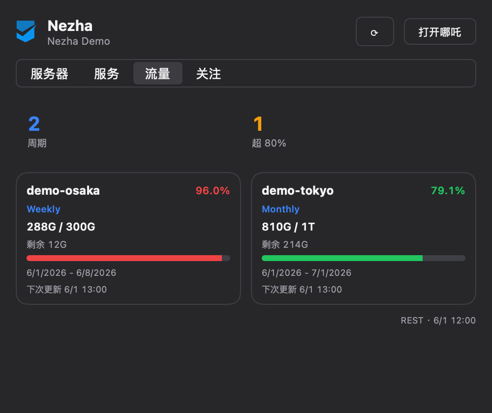

# Nezha for Metrix.Bar

[](LICENSE)
[](https://metrix.bar/)
[](https://nezha.wiki/)

哪吒监控 V2（[Nezha Monitoring](https://nezha.wiki/)）的 [Metrix.Bar](https://metrix.bar/) 菜单栏与桌面小组件 —— 在 macOS / Windows / Linux 上随时查看多台服务器的在线状态、带宽与资源占用，服务探测可用性，以及需要关注的事项。

**English:** A read-only Metrix.Bar menu-bar and desktop-widget dashboard for Nezha Monitoring V2 — multi-server status, bandwidth, service probes, and an attention stream.

| Servers（2 列网格 + 汇总） | 单机详情（指标曲线） |
| --- | --- |
|  |  |

| Services（服务探测） | Alerts（关注事项） |
| --- | --- |
|  |  |

| Traffic（周期流量与剩余配额） | Light（浅色主题） |
| --- | --- |
|  |  |

面板高度会随分组内实例数自适应收缩，实例较多时可滚动。

## 功能

- **托盘** — `21/21 · 1.2M/s` 在线数 + 总带宽（另有 3 种格式可配）；错误时保留最后数值；菜单：刷新 / 打开哪吒 / 清空关注
- **服务器 Tab** — 哪吒原生分组 + 星标 Watchlist（`全部 / 已选` 切换，托盘与汇总跟随关注范围；空关注 = 全部）
  - 顶部汇总卡：在线 x/y、↓/↑ 实时带宽、平均 CPU；第二行累计 ↓↑ 流量；异常数（离线 + 探测失败）；离线机器的旧速率不会计入实时汇总
  - 2 列紧凑卡片：CPU / MEM / DISK 连续进度条、↓↑ 实时速率、累计 ↓↑ 流量、load1；离线旧数据降低突出程度并显示最后活跃时间
  - 超过 6 台时支持名称 / 备注搜索；分组较多时自动切换为完整下拉选择；支持一台机器属于多个分组
  - 点击单机 → 详情：规格、当前状态、实时与累计流量、1 天 / 7 天指标历史曲线（CPU·内存 与 网络两张图，需 Dashboard 启用 TSDB）
  - 详情页「网络延迟」：前 8 条监控点延迟曲线 + 全量监控点网格（当前延迟、丢包率）
  - 详情页「在线情况」：在线率 / 累计在线 / 累计离线 / 最后活跃 + 每日在线时长条（`/api/v1/server/{id}/online-history`）
  - 面板按实际行数精确收缩，默认完整显示最多四排卡片；超过四排保持高度并滚动，分组/搜索切换不留下多余空白；面板内显示更新通道、时间与刷新错误
- **桌面小组件** — small / medium / large 三种尺寸，四种可配置内容：全局总览、单服务器、周期流量、关注事项；单机支持 ID、唯一完整名称或跟随面板选中项，large 复用详情历史曲线
  - 总览以紧凑数值和状态文本显示在线、↓↑ 带宽、平均 CPU 与累计流量；单机包含资源、速率、load1 与并排历史图；流量/关注列表按尺寸显示 1 / 2 / 6 条，避免溢出
  - 点击卡片打开或聚焦看板；同一看板实例的所有卡片共用一种 Widget 模式。修改模式或服务器时立即通知系统重绘；系统决定数据刷新时机，仅 Widget 保持活跃时自动轮询最低为 1 分钟，不承诺秒级实时
- **流量 Tab** — 周期流量提醒（来自 `/api/v1/service` 的 `cycle_transfer_stats`）：每条周期一张卡，显示已用/配额、剩余量、占比条、周期起止、下次更新；≥80% 变橙、≥95% 变红
- **服务 Tab** — HTTP / Ping / TCP 探测列表：存活率、最新延迟、失败标红；类型过滤
- **关注 Tab** — 离线主机 + 失败探测 + 周期流量阈值；相对时间、类型标记；点击离线/流量项进入对应服务器详情，探测项进入服务列表；PAT 带 `nezha:alertrule:read` 时附完整告警规则摘要
- **通知** — 服务器离线 / 探测失败 / 流量跨越 80% 或 95% 时发桌面通知，仅在状态翻转或阈值上升时触发一次（可在 Inputs 分别关闭）
- **认证** — 游客模式（站点需允许未登录读取）或 PAT；强制登录站点会显示明确的「请填写 API Token」提示
- **数据通道** — `liveUpdates` 开启时，游客站点使用 `/api/v1/ws/server` WebSocket + 每 30 秒 REST 对账；关闭后完全使用 REST。PAT 始终按配置间隔（2–60s）进行 REST 轮询（Worker 的 WebSocket 无法携带 `Authorization` 头，把 PAT 放进 URL 会泄漏）
- **分级刷新** — 服务数据至少 15 秒、设置与分组 5 分钟、告警规则 60 秒更新一次；手动刷新立即拉取全量。详情请求并行、去重，缓存最多保留 8 个服务器/周期条目
- **只读** — 不做终端、文件管理、MCP 等写操作

## 安装

### 方式 A：通过 registry（推荐）

在 Metrix.Bar **Settings → Registries** 添加 [Awesome.Metrix.Bar](https://awesome.metrix.bar/)：

```text
https://awesome.metrix.bar/dashboards/index.json
```

然后从目录中安装 **Nezha**。

### 方式 B：手动导入

1. 下载 [nezha.bar](nezha.bar)
2. 在 Metrix.Bar 中导入该文件并确认权限（仅申请你填写的 Dashboard 域名网络访问）

## 配置（Inputs）

| 输入 | 类型 | 说明 |
| --- | --- | --- |
| `baseURL` | string（必填） | Dashboard 地址，如 `https://nezha.example.com` |
| `apiToken` | secret（可选） | PAT（`nzp_…`）。推荐 scope：`nezha:inventory:read`、`nezha:server:read`、`nezha:service:read`，可选 `nezha:alertrule:read`。站点开启 `force_auth` 时必填 |
| `refreshInterval` | select | 轮询间隔：2s / 5s（默认）/ 10s / 30s / 60s |
| `liveUpdates` | bool | 游客模式使用 WebSocket + 30 秒 REST 对账（默认开）；关闭则完全 REST；PAT 始终 REST |
| `trayFormat` | select | 托盘显示：`21/21 · 1.1M/s` / `1.1M/s` / `21/21 · ↑Up ↓Down` / `21/21` |
| `widgetMode` | select | 桌面小组件：`overview` 总览（默认）/ `server` 单机 / `traffic` 周期流量 / `attention` 关注 |
| `widgetServer` | string（可选） | 单机 Widget 留空时跟随面板选中的服务器；也可输入 ID 或不区分大小写的唯一完整名称，重名时须使用 ID |
| `offlineNotify` | bool | 服务器离线桌面通知（默认开） |
| `probeNotify` | bool | 探测失败桌面通知（默认开） |
| `trafficNotify` | bool | 周期流量跨越 80% / 95% 时通知（默认开） |

PAT 在管理前端 **设置 → API Tokens** 创建；Token 只会保存在系统凭据库（secret input），不会出现在源码或日志中。

在系统小组件选择器中添加 **Metrix.Bar** 并选择 **Nezha**，即可放置桌面卡片。macOS 需要 14+ 与 Metrix.Bar 0.2.0+；Windows 11 22H2+ 和 KDE Plasma 6 的支持范围以 Metrix.Bar 文档为准。**同一实例的多张 Nezha 卡片只能显示相同内容，不能逐卡选择模式**；系统控制刷新时机，仅 Widget 保持活跃时最快每分钟更新一次。设置标签、选项和帮助文本通过 `<locale lang="zh-Hans">` 跟随 App 的简体中文界面，默认英文。静态 `<docs>` 配置说明不支持按 App 语言切换，因此采用中文在前、英文在后的完整双语说明。

## 开发

```sh
git clone https://github.com/bluenight91/nezha-metrix-bar
node --test helpers.test.mjs runtime.test.mjs   # 纯函数 + 真实 .bar 脚本运行时报测（64 个）
```

- `nezha.bar` — 看板本体（单文件，协议 v0）
- `helpers.mjs` — 纯函数（数据合并 / 汇总 / 格式化），同步内联进 `nezha.bar`
- `helpers.test.mjs` — Node 内置 test runner 的纯函数单元测试
- `runtime.test.mjs` — 使用 mock fetch / WebSocket 执行真实 `.bar` 脚本，覆盖连接切换、WS 开关、分级轮询、超时、详情并发去重、面板高度和 Widget 主要交互
- `assets/` — 截图（由 Metrix.Bar Local API `/v0/check` 的 fixture + screenshot 功能渲染，只使用虚构数据）

质量门：Metrix.Bar Local API `/v0/validate` + 带 fixture 的 `/v0/check`（Tab、星标、关注过滤、搜索、详情进出、告警跳转、四种 Widget 模式与三种尺寸）。

## 兼容性

- Nezha Monitoring **V2**（REST 路径为 `/api/v1` —— 路径版本与产品代际独立，勿改为 `/api/v2`）
- Metrix.Bar protocol v0；桌面 Widget 需要 Metrix.Bar 0.2.0+，macOS 桌面卡片需要 macOS 14+

## 更新日志

见 [CHANGELOG.md](CHANGELOG.md)。

## 许可

[AGPL-3.0-only](LICENSE)。图标来自 [LogoHub 的 Nezha 官方标志](https://logohub.afengblog.com/logo/nezha)（彩色版 + 暗色模板版）。
