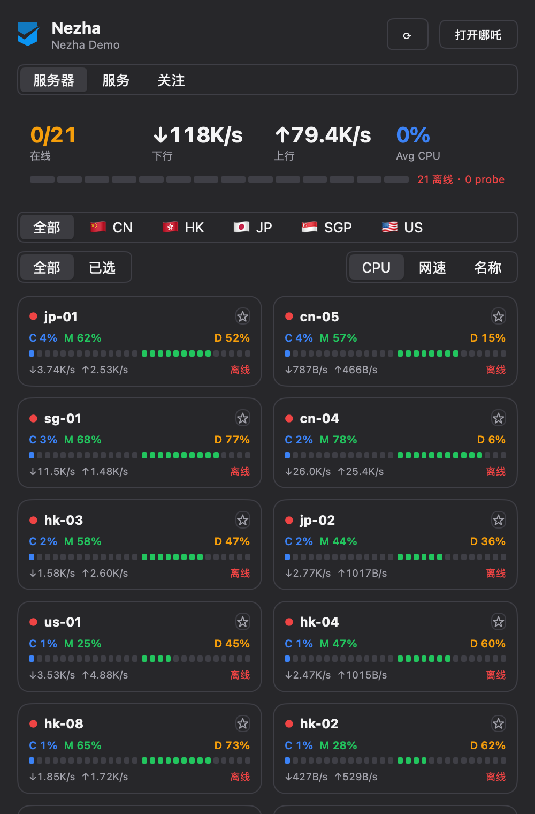
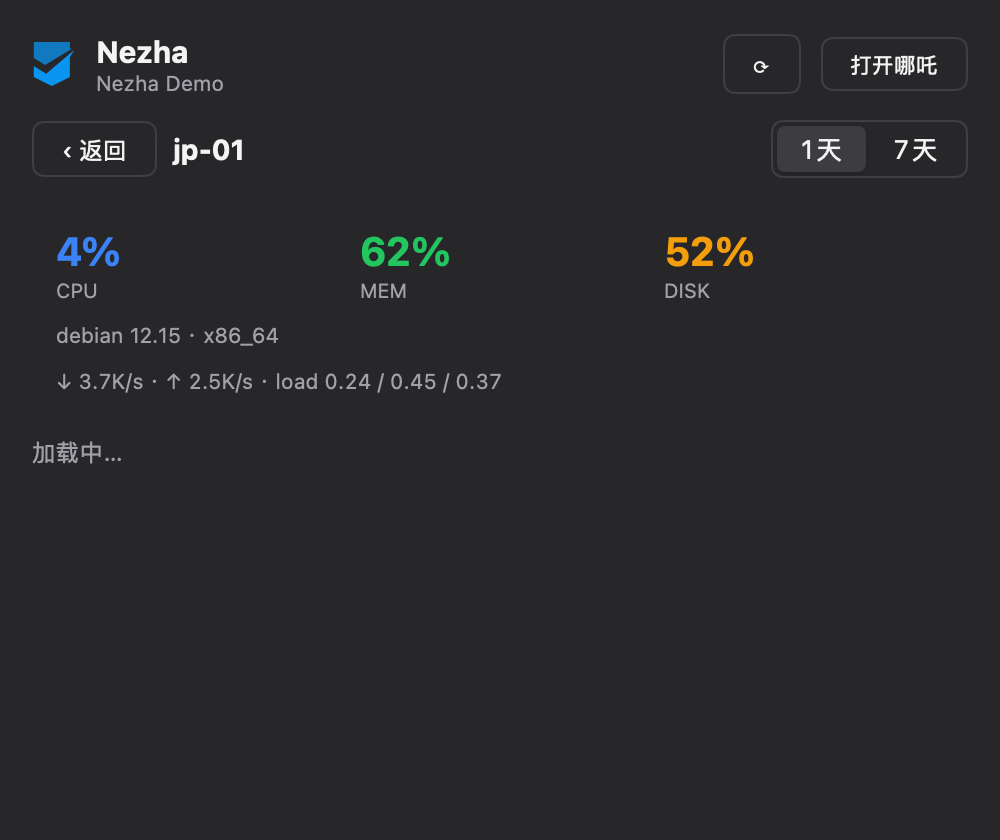
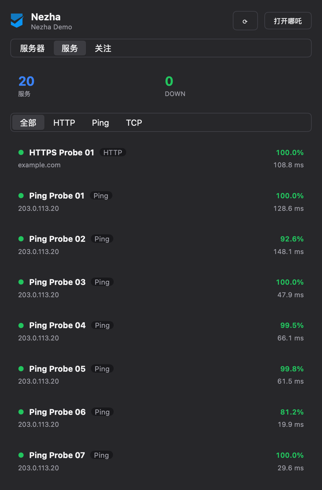
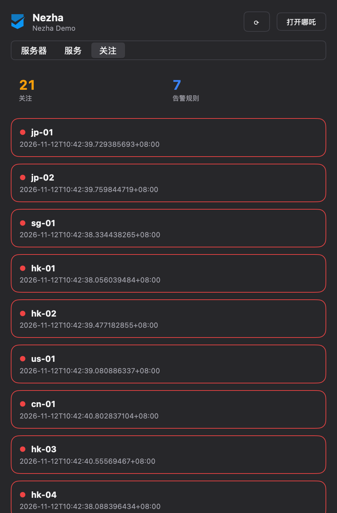
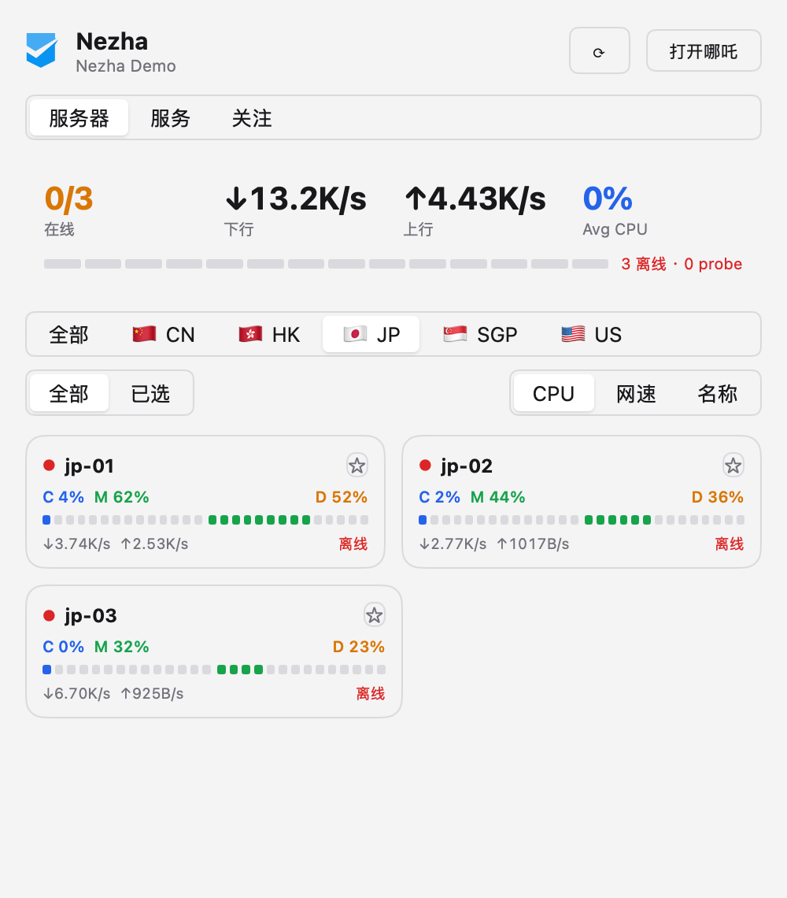

# Nezha for Metrix.Bar

[](LICENSE)
[](https://metrix.bar/)
[](https://nezha.wiki/)

哪吒监控 V2（[Nezha Monitoring](https://nezha.wiki/)）的 [Metrix.Bar](https://metrix.bar/) 菜单栏看板 —— 在 macOS / Windows / Linux 的菜单栏里随时查看多台服务器的在线状态、带宽与资源占用，服务探测可用性，以及需要关注的事项。

**English:** A read-only Metrix.Bar menu-bar dashboard for Nezha Monitoring V2 — multi-server status, bandwidth, service probes, and an attention stream, right in your menu bar.

| Servers（2 列网格 + 汇总） | 单机详情（指标曲线） |
| --- | --- |
|  |  |

| Services（服务探测） | Alerts（关注事项） |
| --- | --- |
|  |  |

浅色主题（分组内实例少时面板高度自适应收缩）：



## 功能

- **托盘** — `21/21 · 1.2M/s` 在线数 + 总带宽（另有 3 种格式可配）；错误时保留最后数值；菜单：刷新 / 打开哪吒 / 清空关注
- **服务器 Tab** — 哪吒原生分组（Segmented）+ 星标 Watchlist（`全部 / 已选` 切换，托盘与汇总跟随关注范围；空关注 = 全部）
  - 顶部汇总卡：在线 x/y、↓/↑ 实时带宽、平均 CPU、异常数（离线 + 探测失败）
  - 2 列紧凑卡片：CPU / MEM / DISK 胶囊条、↓↑ 速率、load1
  - 点击单机 → 详情：规格、实时资源、1 天 / 7 天指标历史曲线（CPU·内存 与 网络两张图，需 Dashboard 启用 TSDB，未启用时显示提示）
  - 面板高度按分组实例数自适应（420–760 DIP），少则收缩、多则滚动
- **服务 Tab** — HTTP / Ping / TCP 探测列表：存活率、最新延迟、失败标红；类型过滤
- **关注 Tab** — attention 流：离线主机 + 失败探测；PAT 带 `nezha:alertrule:read` 时附告警规则摘要（游客模式也不会空白）
- **通知** — 服务器离线 / 探测失败时发桌面通知，仅在状态翻转时触发一次（可在 Inputs 关闭）
- **认证** — 游客模式（站点需允许未登录读取）或 PAT；强制登录站点会显示明确的「请填写 API Token」提示
- **数据通道** — 游客可访问的站点走 `/api/v1/ws/server` WebSocket 实时流（自动重连，最多 3 次）；PAT 模式按配置间隔（2–60s）REST 轮询（Worker 的 WebSocket 无法携带 `Authorization` 头，把 PAT 放进 URL 会泄漏，故 PAT 模式不尝试 WS）
- **只读** — 不做终端、文件管理、MCP 等写操作

## 安装

### 方式 A：通过 registry（推荐）

在 Metrix.Bar **Settings → Registries** 添加 [Awesome.Metrix.Bar](https://awesome.metrix.bar/)：

```text
https://awesome.metrix.bar/dashboards/index.json
```

然后从目录中安装 **Nezha**。

### 方式 B：手动导入

1. 下载 [nezha.bar](nezha.bar)
2. 在 Metrix.Bar 中导入该文件并确认权限（仅申请你填写的 Dashboard 域名网络访问）

## 配置（Inputs）

| 输入 | 类型 | 说明 |
| --- | --- | --- |
| `baseURL` | string（必填） | Dashboard 地址，如 `https://nezha.example.com` |
| `apiToken` | secret（可选） | PAT（`nzp_…`）。推荐 scope：`nezha:inventory:read`、`nezha:server:read`、`nezha:service:read`，可选 `nezha:alertrule:read`。站点开启 `force_auth` 时必填 |
| `refreshInterval` | select | 轮询间隔：2s / 5s（默认）/ 10s / 30s / 60s |
| `trayFormat` | select | 托盘显示：`21/21 · 1.1M/s` / `1.1M/s` / `21/21 · ↑Up ↓Down` / `21/21` |
| `offlineNotify` | bool | 服务器离线桌面通知（默认开） |
| `probeNotify` | bool | 探测失败桌面通知（默认开） |

PAT 在管理前端 **设置 → API Tokens** 创建；Token 只会保存在系统凭据库（secret input），不会出现在源码或日志中。

## 开发

```sh
git clone https://github.com/bluenight91/nezha-metrix-bar
node --test helpers.test.mjs   # 纯函数单元测试（13 个）
```

- `nezha.bar` — 看板本体（单文件，协议 v0）
- `helpers.mjs` — 纯函数（数据合并 / 汇总 / 格式化），同步内联进 `nezha.bar`
- `helpers.test.mjs` — Node 内置 test runner 的单元测试
- `assets/` — 截图（由 Metrix.Bar Local API `/v0/check` 的 screenshot 功能渲染）

质量门：Metrix.Bar Local API `/v0/validate` + 带 fixture 的 `/v0/check`（8 步交互场景：切 Tab、星标、关注过滤、详情进出、返回）。

## 兼容性

- Nezha Monitoring **V2**（REST 路径为 `/api/v1` —— 路径版本与产品代际独立，勿改为 `/api/v2`）
- Metrix.Bar protocol v0

## 许可

[AGPL-3.0-only](LICENSE)。图标来自 [LogoHub 的 Nezha 官方标志](https://logohub.afengblog.com/logo/nezha)（彩色版 + 暗色模板版）。
